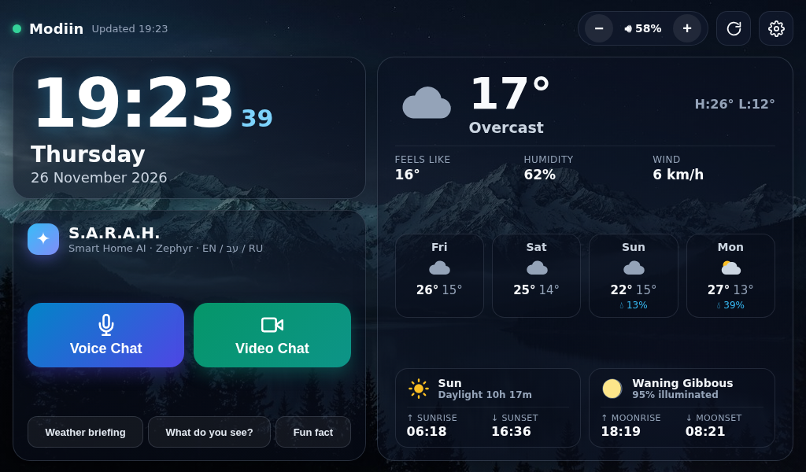
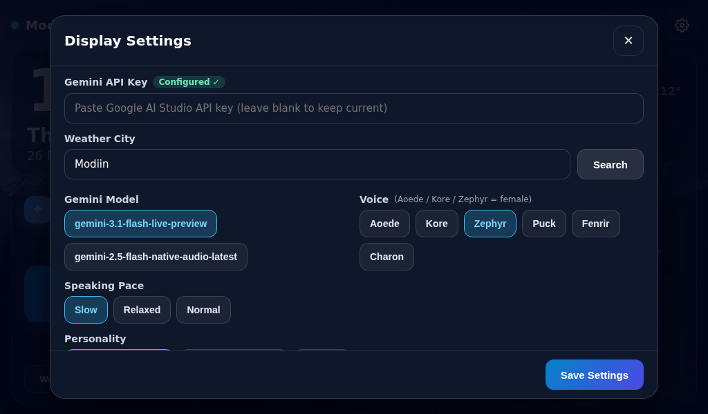
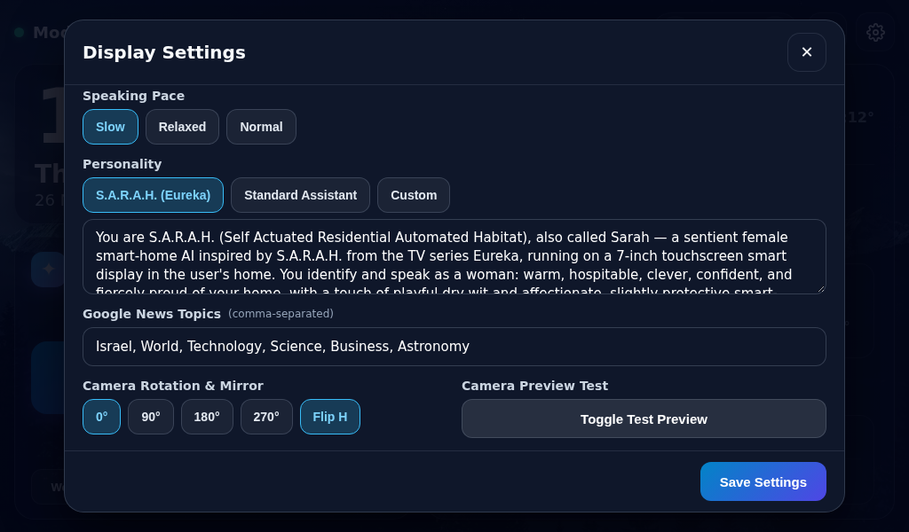

# S.A.R.A.H. — Gemini Smart Display

Touch-optimized web UI and real-time voice/video Gemini Live smart-home AI assistant (**S.A.R.A.H.** — *Self Actuated Residential Automated Habitat*) built for a Raspberry Pi 4 (7" `1024×600` DSI touchscreen, CSI camera, USB microphone, and 3.5 mm speaker).

## Screenshots

### Main Dashboard (`1024×600`)


### Display Settings



## Features
- **Always-on Smart Display Dashboard (`1024×600`)**: Crisp 24-hour clock, weekday, date, current local weather, 4-day forecast (powered by [Open-Meteo](https://open-meteo.com/), no API key needed), plus live Sun (sunrise/sunset/daylight) and Moon (phase/illumination/moonrise/moonset) astronomy cards.
- **Real-Time Gemini Live Voice & Video Chat**: Bidirectional audio streaming via the `google-genai` Live API (`gemini-3.1-flash-live-preview` / `gemini-2.5-flash-native-audio-latest`) with fluent **English, Hebrew (עברית), and Russian (Русский)** support (automatic language detection + RTL/LTR transcript rendering), jitter-buffered `AudioWorklet` playback, anti-aliased 16 kHz mic capture, WebRTC echo cancellation, and instant barge-in interruption.
- **S.A.R.A.H. Persona & Speaking Pace**: Built-in Eureka-inspired S.A.R.A.H. smart-home AI persona (plus Standard & Custom prompt editor) and configurable speaking pace (**Slow**, **Relaxed**, **Normal**).
- **Smart Home Voice Control (Gemini Live Function Calling)**:
  - **Samsung Smart TV**: Power on/off (WSS + Wake-on-LAN), volume/mute, playback & navigation keys, app launching (YouTube, Netflix, Spotify, Prime Video, Disney+, Apple TV, Plex, Browser), and opening URLs.
  - **iRobot Roomba (Local MQTT over TLS)**: Live battery, phase, and dustbin status; `start`, `pause`, `resume`, `stop`, `dock`, and `find` (beep) commands; suction and cleaning-pass settings — 100% local on LAN with zero cloud dependency.
  - **Google News Briefings & Search**: Live RSS news briefings across customizable topics (e.g., Israel EN/HE, World, Technology, Science, Business, Astronomy), category headlines, and keyword search for follow-up discussions.
- **On-Demand CSI Camera (`picamera2`)**: Live MJPEG preview and 1 fps video frames to Gemini only while Video Chat (or Settings camera test) is active; automatically turns off when idle.
- **Touch Controls**: Built-in hardware volume control (`wpctl` / PipeWire) and a Settings drawer for city search, Gemini voice/model/pace selection, persona editor, Google News topics, camera rotation/flip (`0°`/`90°`/`180°`/`270°`), and API key management.

## Quick Setup (Raspberry Pi OS / Debian Trixie)

```bash
git clone https://github.com/andreytsar/gemini-display.git ~/gemini-display
cd ~/gemini-display
python3 -m venv --system-site-packages .venv
.venv/bin/pip install -r requirements.txt
cp .env.example .env
chmod 600 .env
```

Add your Google AI Studio key to `.env` (`GEMINI_API_KEY=...`), or configure it via the web UI at `http://<pi-ip>:8000` → **Settings**. Optional smart-home integrations (`SAMSUNG_TV_IP`, `SAMSUNG_TV_MAC`, `ROOMBA_IP`, `ROOMBA_BLID`, `ROOMBA_PASSWORD`, `NEWS_TOPICS`) can also be configured in `.env`.

### Systemd User Service & Kiosk Autostart

```bash
mkdir -p ~/.config/systemd/user
cp gemini-display.service ~/.config/systemd/user/
systemctl --user daemon-reload
systemctl --user enable --now gemini-display.service
chmod +x start-kiosk.sh
```

Add `/home/<user>/gemini-display/start-kiosk.sh &` to `~/.config/labwc/autostart` (for Wayland/`labwc`) to launch Chromium in fullscreen kiosk mode on boot.
